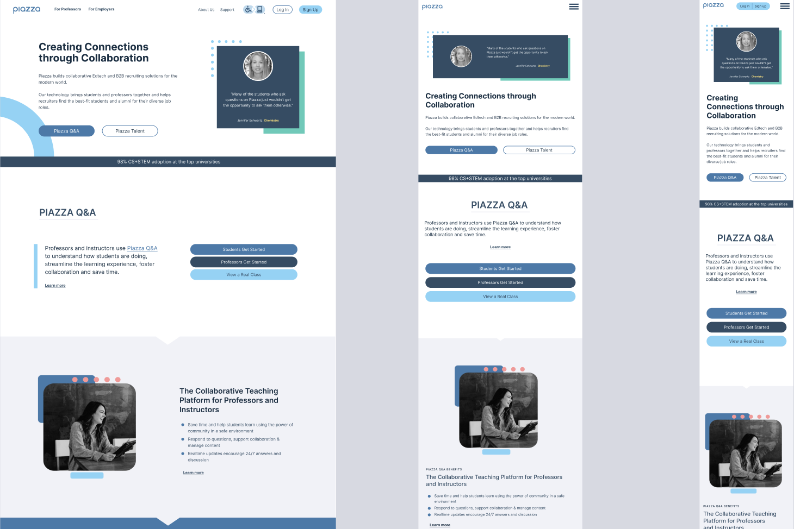
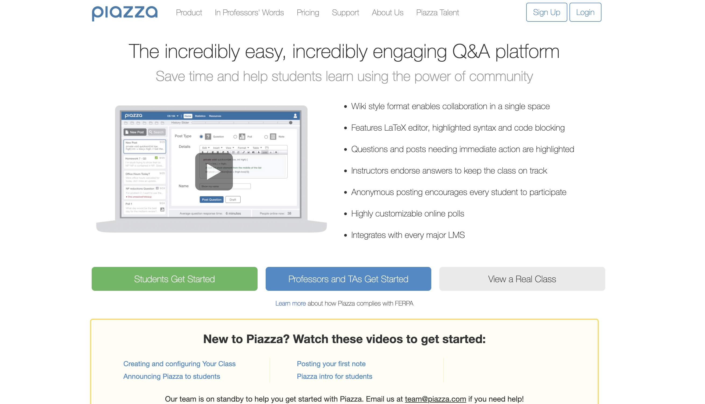
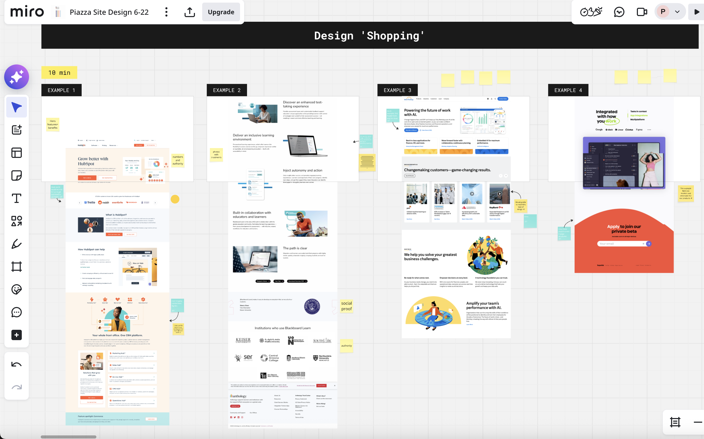
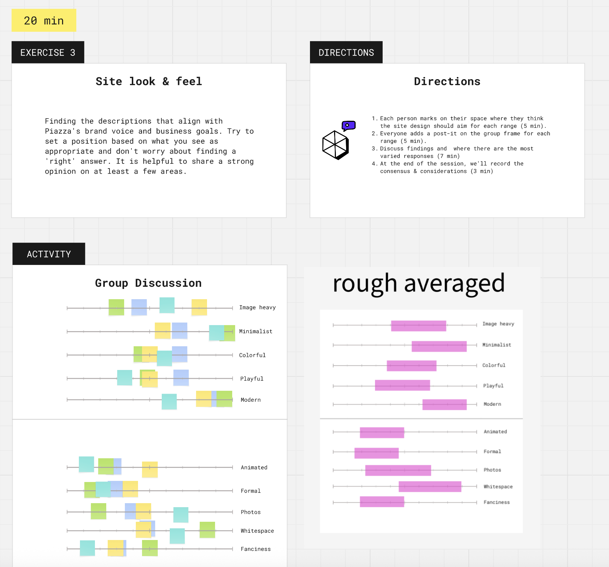
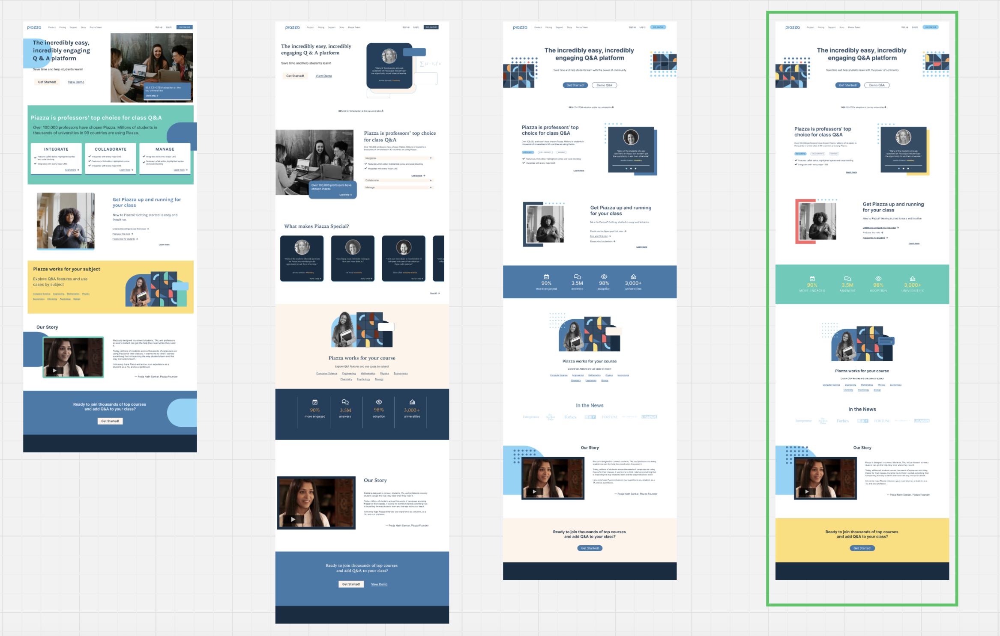
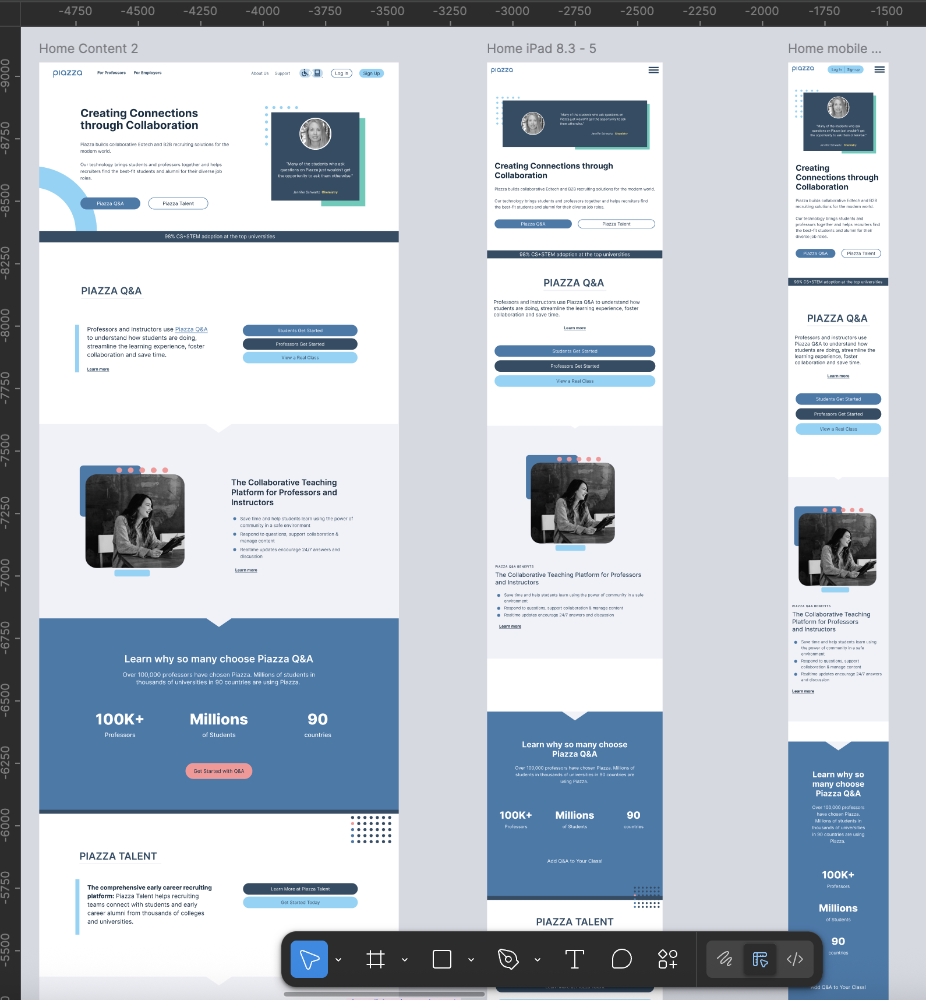
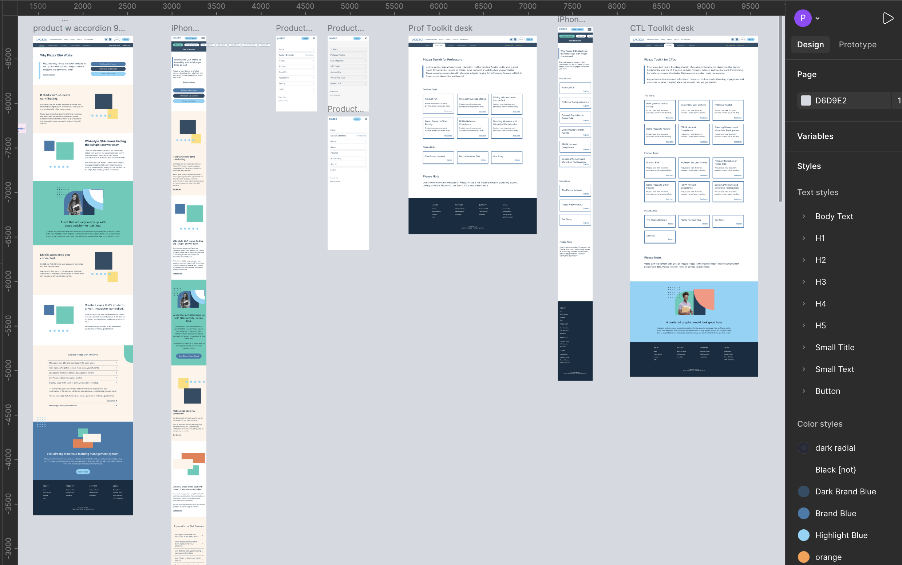
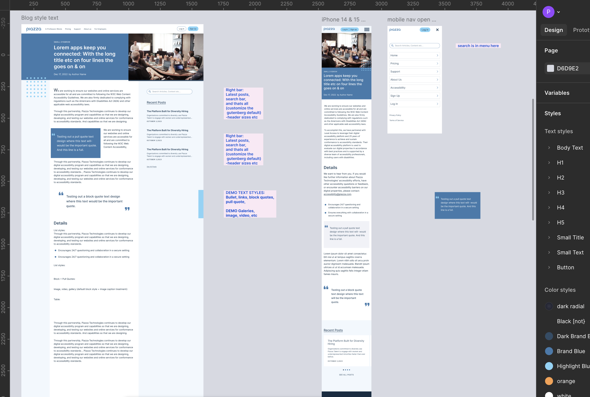

### A design sprint to modernize a university ed-tech platform that wasn't working — visually or functionally.

**My role:** UX/UI Design, Design Workshop Facilitation, Visual Direction, Developer Handoff

**The Problem**

Piazza is a widely-used ed-tech platform connecting students and instructors. Despite strong utility, the product suffered from an outdated visual design and a website that wasn't keeping pace with modern UX standards — creating friction for users and undermining trust in the brand.

The ask: lead a focused design sprint to align stakeholders, define a clear visual direction, and produce responsive designs ready for developer handoff.

 

**Starting Point**

The existing site had usability and aesthetic issues that stakeholders knew needed addressing — but hadn't yet aligned on what "better" looked like. Before design work could begin, we needed to surface those opinions and build consensus around a shared vision.

## Design Sprint Process

#### 1 — Lead a Remote Design Workshop

I facilitated a remote workshop with stakeholders using Miro, combining sticky note exercises and visual slider exercises to draw out honest reactions to existing designs.

**Key question:** *"What do you like and dislike about these page designs?"*

This surfaced real opinions quickly and gave everyone a shared vocabulary for what wasn't working — and what to aim for.

 

#### 2 — Gather and Align Design Visions

With reactions on the table, I moved into alignment exercises to understand how stakeholders imagined the redesigned site. Slider exercises helped translate subjective preferences — minimal vs. bold, clean vs. expressive — into actionable design parameters.

**Key question:** *"How do you imagine the redesigned website?"*

 

#### 3 — Present Three Visual Directions

From the workshop findings I developed three distinct visual directions, each exploring a different design language within the established constraints. Presenting multiple directions early — even at high fidelity — lets clients experience real options rather than reacting abstractly.

The outcome was a hybrid direction: taking the strongest elements from each concept and combining them into a unified approach.

*Note: this kind of early high-fidelity work is more effort upfront, but it builds stakeholder confidence and dramatically reduces revision cycles later.*

 

#### 4 — Design Responsive Screens & Components for Handoff

With a clear direction locked, I designed the full site — homepage, product portal, and blog section — at responsive breakpoints, with a complete component library for developer handoff.

**Home Page**

 

**Product Portal**

 

**Blog Section**

**Takeaways**

The design sprint format worked well here — structured enough to move fast, flexible enough to surface the real stakeholder needs that would have taken weeks to uncover through a traditional process. Getting alignment before designing saved significant rework and gave the final designs a clear rationale everyone had participated in building.
