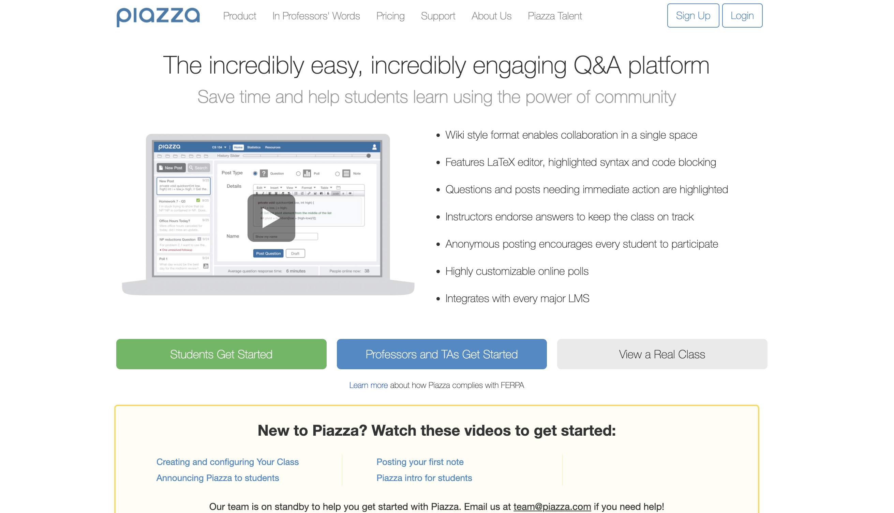
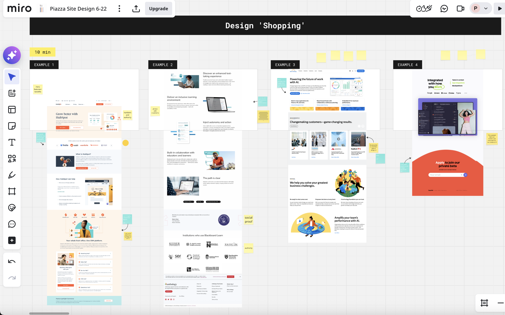
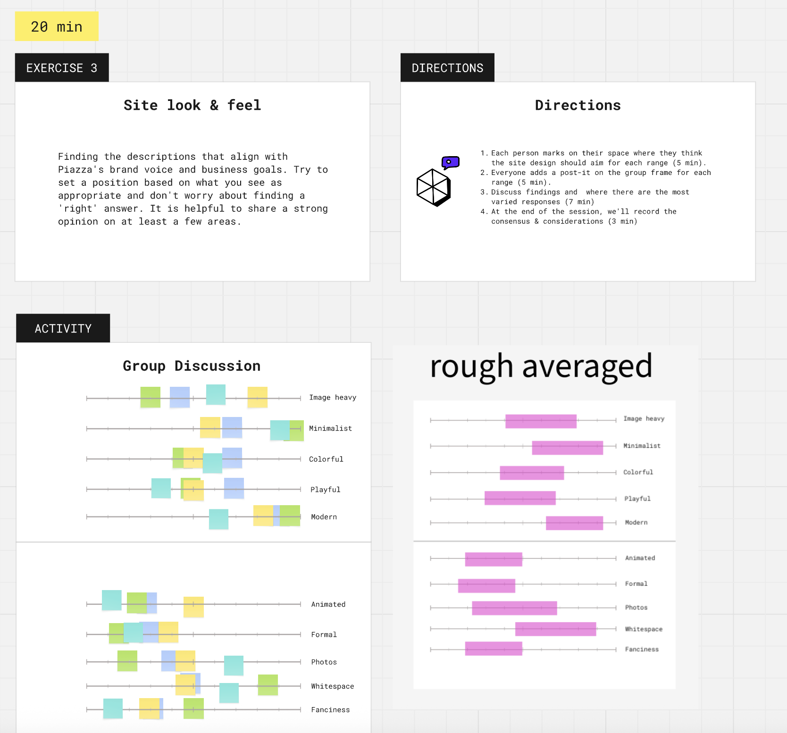
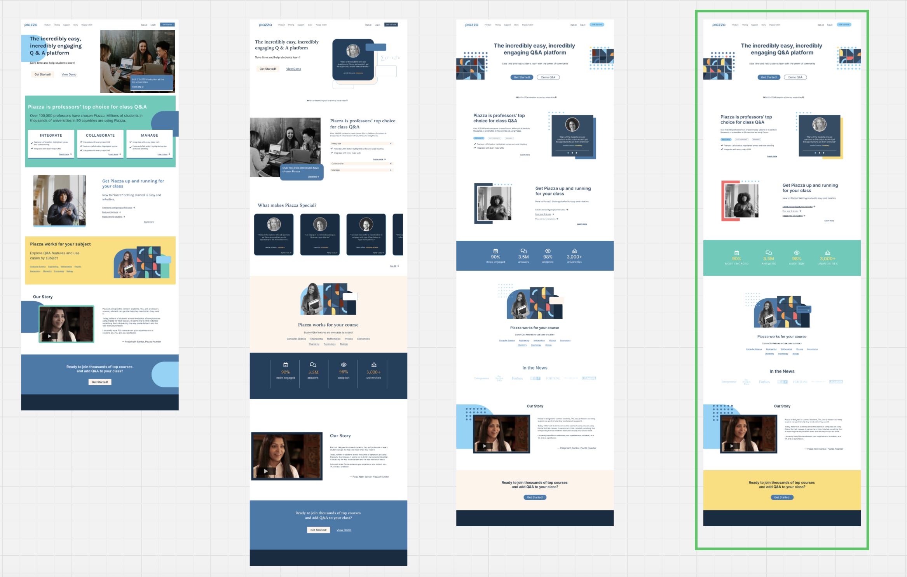
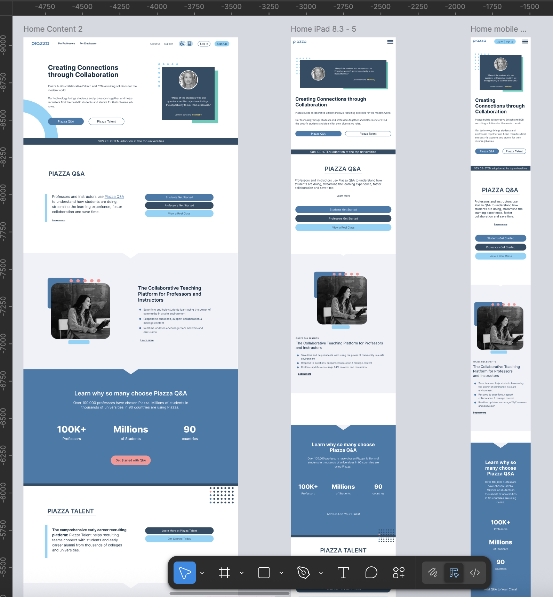
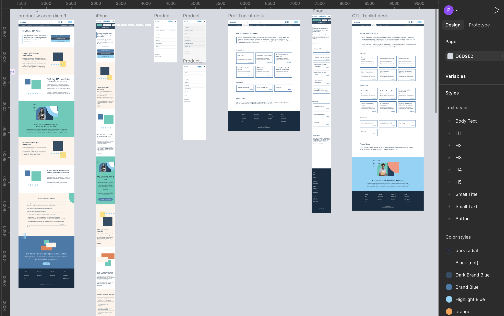
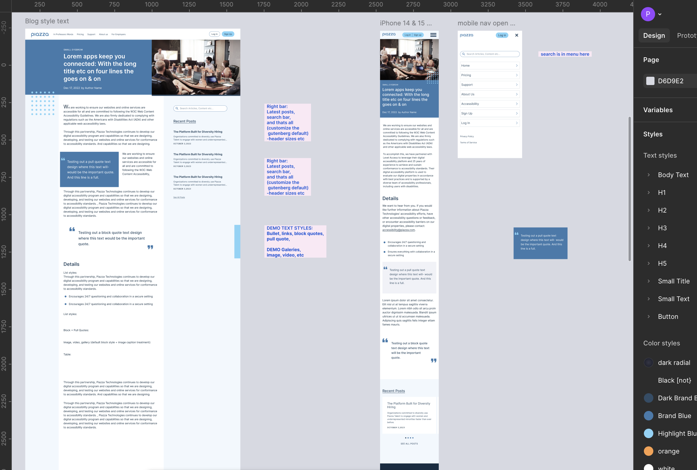

# Untitled

# PIAZZA - Ed-Tech Platform- Design Sprint

### Alignment • Product Design • Modern UX/Ui in Figma

**THE PROBLEM** - “A Website that doesn’t work well or look modern”

## DESIGN SPRINT PROCESS

#### 1) Lead a remote design workshop for stakeholders (sticky notes, slider exercises)

“What do you like and dislike about these page designs?”

#### 2) Gather and Align Design Visions and Needs

“How do you imagine the redesigned website?”

#### 3) Present 3 visual directions & (Choose the best of each)

*sometimes a client requires lots of high-fidelity design early on (It’s easier when they don’t)

#### 4) Design responsive screens & site components for developer handoff

Home Page

Product Portal

Blog Section

